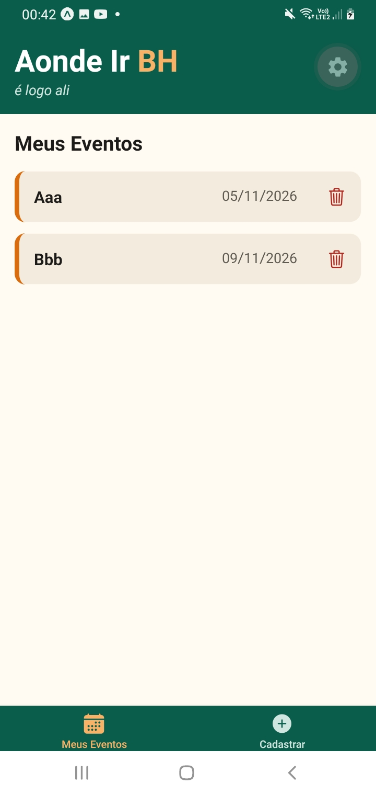
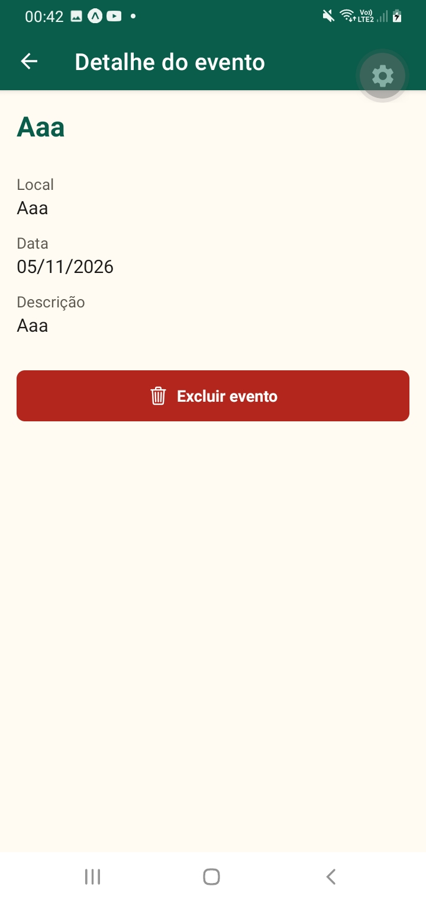
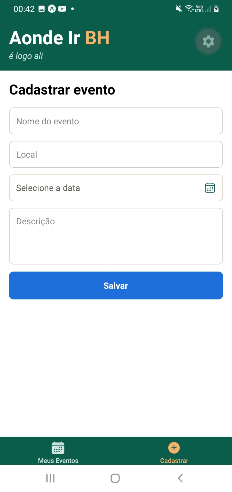
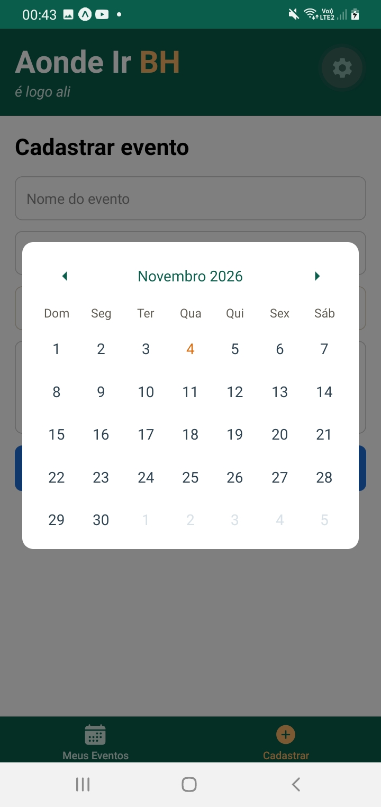

# Aonde Ir BH 🚌

> é logo ali

App mobile para organizar e descobrir eventos em Belo Horizonte.
Trabalho da disciplina de desenvolvimento mobile — Newton Paiva Wyden.

<p align="center">
  
  
  
  
</p>

## Funcionalidades
- Cadastro de eventos (nome, local, data e descrição)
- Lista "Meus Eventos" em cards
- Tela de detalhe do evento
- Exclusão de eventos
- Seleção de data por calendário

## Tecnologias
React Native · Expo (Expo Router) · TypeScript · SQLite (`expo-sqlite`)

## Como rodar
```bash
npm install
npx expo start
```
Escaneie o QR code com o app **Expo Go**, ou pressione `w` para abrir no navegador.

> O banco SQLite é **local**: os dados ficam no aparelho (ou no navegador).
> Ao rodar pela primeira vez, o app começa vazio. Cadastre alguns eventos para testar.

## Estrutura
```
app/         telas (abas e detalhe)
components/  componentes reutilizáveis
constants/   cores da identidade visual
database/    criação da tabela
utils/       funções auxiliares
```

## Próximos passos
- [ ] Aba de pontos turísticos
- [ ] Favoritos
- [ ] Busca "É logo ali"
- [ ] Rotas de ônibus até o destino

## Autor
Bernardo Augusto Gontijo Dias